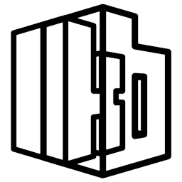
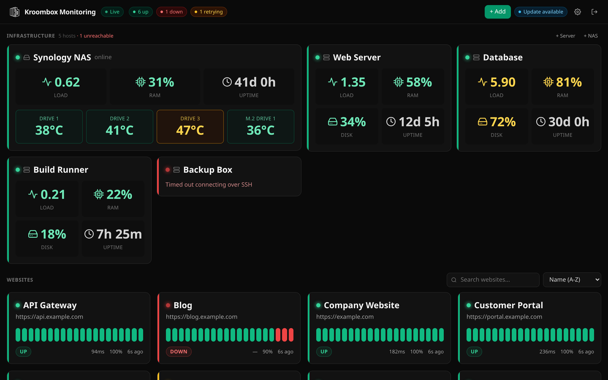

<h1>
  <picture>
    <source media="(prefers-color-scheme: dark)" srcset="docs/logo-dark.png">
    
  </picture>
  Kroombox Monitor
</h1>

Dashboard monitoring real-time yang di-host sendiri untuk **website**, **server Linux**, dan **NAS**: cukup satu layanan Node.js kecil, tanpa database, dan tanpa agen yang harus dipasang di mesin yang dipantau.



*[Read in English](README.md)*

## Fitur

- **Website**: cek HTTP(S) dengan interval sendiri, response time, heartbeat bar, dan persentase uptime. Cek yang gagal dicoba ulang dulu (tampil kuning sebagai *RETRYING*, jumlah dan jeda retry diatur sendiri) dan baru dinyatakan *DOWN* kalau semua retry juga gagal, jadi gangguan sesaat tidak langsung membunyikan alarm.
- **Server**: load average, RAM, pemakaian disk root, dan uptime lewat SSH (password atau private key). Satu koneksi SSH per host dibuka sekali lalu dipakai ulang, jadi refresh tiap 1 detik tetap ringan.
- **NAS**: metrik SSH yang sama, ditambah suhu dan status SMART tiap disk dari **Synology DSM**.
- **Semua diatur dari UI**: tambah website, server, dan NAS sebanyak apa pun; edit, jeda, atau hapus. Tombol *Test connection* mengecek SSH/DSM sebelum disimpan.
- **Live**: browser menerima pembaruan lewat WebSocket, tanpa polling dan tanpa refresh halaman.
- **Notifikasi suara di browser** saat website, server, atau NAS down atau pulih, dengan jam senyap. Suaranya bisa diganti sendiri lewat Settings.
- **Branding sendiri**: nama aplikasi dan logo diatur di Settings.
- **Aman sejak awal**:
  - semua halaman wajib login;
  - password pertama dibuat acak;
  - percobaan login dibatasi;
  - kredensial disimpan khusus pemilik (`0600`) dan tidak pernah dikirim balik ke browser;
  - unit systemd sudah di-hardening.

## Kebutuhan

- Linux dengan **systemd** (Ubuntu, Debian, Fedora, Rocky/Alma, Arch, dll.).
- **Node.js 20 LTS atau lebih baru** (18.18+ juga jalan), npm, `rsync`, dan `git`.
- Server/NAS yang dipantau: akses SSH dengan user yang bisa membaca `/proc` dan menjalankan `df` (user biasa sudah cukup).
- Untuk suhu disk NAS: akun Synology DSM di grup *administrators*, tanpa 2FA.

## Pemasangan (systemd)

```bash
git clone https://github.com/andiahmadnurmadani/uptime-monitor.git
cd uptime-monitor
sudo ./scripts/install.sh
```

Installer akan:

1. Membuat user sistem `kroombox-monitor`.
2. Menyalin aplikasi ke `/opt/kroombox-monitor`, memasang dependensi, lalu build.
3. Menulis konfigurasi ke `/etc/kroombox-monitor/kroombox-monitor.env` dan menyimpan data di `/var/lib/kroombox-monitor`.
4. Menanyakan password login. Kalau dikosongkan, password acak dibuat dan ditampilkan di akhir.
5. Memasang dan menjalankan `kroombox-monitor.service`.

Setelah itu, buka `http://<ip-server>:3400`, login, lalu pakai tombol **+ Add** untuk menambah website, server, dan NAS.

Opsi yang sering dipakai:

```bash
sudo ./scripts/install.sh --port 8080                      # port lain
sudo ./scripts/install.sh --bind 127.0.0.1 --trust-proxy   # di belakang nginx/Caddy/Cloudflare Tunnel
sudo ADMIN_PASSWORD='password-panjang' ./scripts/install.sh  # tanpa interaksi
```

### Mengelola layanan

```bash
kroombox-monitor status        # status systemd
kroombox-monitor logs          # ikuti log
kroombox-monitor restart
kroombox-monitor passwd        # reset login dashboard (mis. lupa password)
kroombox-monitor check-update  # cek versi baru di GitHub
kroombox-monitor update        # git pull + build ulang, data tetap
kroombox-monitor uninstall     # hapus layanan, data tetap (--purge untuk ikut menghapus data)
```

### Update dari dashboard

Installer juga memasang updater kecil yang berjalan sebagai root (`kroombox-monitor-updater.service`). Updater mengecek GitHub tiap 6 jam; kalau ada versi baru, header dashboard menampilkan **Update available**, dan **Settings → Updates → Update now** memasangnya (sama dengan `kroombox-monitor update`): folder sumber di-fast-forward, aplikasi di-build ulang dan direstart, lalu halaman memuat ulang sendiri. Data dan konfigurasi tetap. Dashboard tidak pernah menjalankan apa pun sebagai root, hanya menaruh file permintaan di `$DATA_DIR/update-requests` yang diambil oleh `kroombox-monitor-updater.path`. Folder sumber harus berupa git clone yang bersih (tanpa perubahan yang belum di-commit).

## Konfigurasi

Website, server, NAS, branding, login, dan jadwal suara semuanya diatur dari UI web. File env hanya berisi pengaturan runtime:

| Variabel | Bawaan | Arti |
|---|---|---|
| `PORT` | `3400` | Port HTTP |
| `BIND_ADDRESS` | `0.0.0.0` | Alamat listen. Pakai `127.0.0.1` kalau hanya reverse proxy/tunnel lokal yang boleh mengakses |
| `DATA_DIR` | `./data` | Lokasi semua data (installer: `/var/lib/kroombox-monitor`) |
| `TRUST_PROXY` | `false` | Set `true` di belakang reverse proxy/Cloudflare Tunnel, agar pembatas login melihat IP asli pengguna |
| `ADMIN_USERNAME` / `ADMIN_PASSWORD` | `admin` / acak | Login pertama; hanya dipakai kalau belum ada akun |
| `APP_NAME` | `Kroombox Monitoring` | Nama tampilan bawaan, sebelum diatur di Settings |

Setelah mengubah `/etc/kroombox-monitor/kroombox-monitor.env`, jalankan `kroombox-monitor restart`.

### Folder data

| File | Isi |
|---|---|
| `monitors.json` | daftar website dan riwayat cek terakhir |
| `hosts.json` | server dan NAS, **termasuk kredensial SSH/DSM** (mode `0600`) |
| `auth.json` | username login, hash password, dan secret sesi (mode `0600`) |
| `settings.json`, `sound-settings.json`, `logo.*` | branding dan jadwal notifikasi |
| `sounds/down.*`, `sounds/recovery.*` | suara notifikasi yang diunggah di Settings (tanpa itu dipakai suara bawaan) |
| `hosts-status.json` | status server terakhir, ditampilkan sesaat setelah restart |

Untuk mencadangkan semuanya, cukup backup folder ini.

## Membuka akses dengan aman

Dashboard ini menyimpan kredensial SSH mesin Anda, jadi perlakukan seperti panel admin:

- Pasang di belakang HTTPS (nginx, Caddy, atau Cloudflare Tunnel), lalu jalankan installer dengan `--bind 127.0.0.1 --trust-proxy`.
- Pakai password login yang panjang. Kalau bisa diakses dari internet, pertimbangkan lapisan akses tambahan (VPN, Cloudflare Access, atau basic auth di proxy).
- Sebaiknya pakai user SSH (atau key) khusus tanpa hak istimewa untuk tiap host. Aplikasi ini hanya menjalankan `cat /proc/...`, `nproc`, dan `df`.

Koneksi ke Synology DSM dibuat tanpa verifikasi sertifikat, karena DSM memakai sertifikat self-signed di port manajemennya. Jadi pastikan lalu lintas ke DSM tetap di jaringan privat atau VPN.

## Upgrade dari versi `.env.local`

Versi sebelumnya membaca `NAS_*` dan `SERVERS_JSON` dari `.env.local`. Saat pertama dijalankan (selama `hosts.json` belum ada), versi ini otomatis mengimpornya ke `hosts.json`. Setelah itu nilai di env diabaikan dan semuanya diubah lewat UI.

Untuk memindahkan instalasi lama ke systemd:

```bash
sudo ./scripts/install.sh --import-data /path/data-lama --import-env /path/.env.local-lama
```

## Pengembangan

```bash
npm install
npm run dev          # http://localhost:3400, data di ./data
npm test             # unit test
npm run lint && npm run typecheck
```

Teknologi yang dipakai: Next.js 15 (App Router) dengan custom server kecil (`server.ts`) yang menambahkan endpoint WebSocket `/ws`, `ssh2` untuk SSH, dan Tailwind CSS.

Poller latar dijalankan di `src/instrumentation.ts`:

- `src/lib/scheduler.ts`: cek website.
- `src/lib/infra-monitor.ts`: satu poller SSH (ditambah poller DSM untuk NAS) per host, disesuaikan otomatis setiap kali daftar host berubah.
- `src/lib/host-store.ts`: penyimpanan konfigurasi host, validasi, dan impor konfigurasi lama.

Kontribusi sangat diterima. Lihat [CONTRIBUTING.md](CONTRIBUTING.md).

## Lisensi

[MIT](LICENSE)
